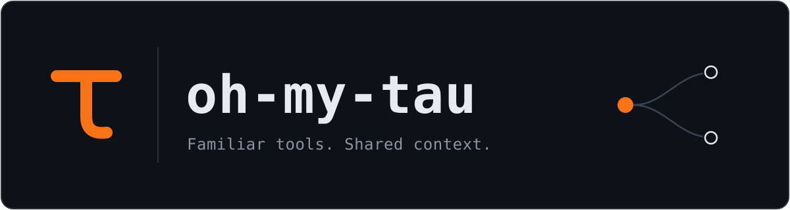

# oh-my-tau



oh-my-tau builds on [Oh My Pi](https://github.com/can1357/oh-my-pi) with model profiles, context-sharing subagents, and a Fusion mode inspired by Devin Fusion. It keeps OMP's tools and integrations while changing how supported models receive instructions and delegate work.

## What is different, and why?

I want supported models to feel at home in OMP. The Claude Code and Codex profiles load locally recorded client prompts and present familiar tool names and schemas. OMP executes these tools. Its tools with no native counterpart remain available.

The goal is to reduce interface differences, not to reproduce the original clients. Conversation forks and Fusion mode extend how agents share context and divide work. These changes do not guarantee identical behavior or cost savings. Provider subscriptions and usage limits still apply.

## Setup

You need Bun, Rust/Cargo, Git, and Python 3 for the installer. Install and sign in to Claude Code or Codex to record the corresponding profile. Connect Devin with `/login devin` or `DEVIN_API_KEY` if you want to use the default SWE-2 sidekick.

1. Install the fork:

   ```sh
   git clone https://github.com/AshishKumar4/oh-my-tau.git
   cd oh-my-tau
   ./scripts/install-harness.sh
   ```

2. Start OMP in your project:

   ```sh
   cd /path/to/your/project
   omp
   ```

3. Inside OMP, use `/login` if needed to connect a provider, then `/model` to choose a supported model. Or select one when starting OMP:

   ```sh
   omp --model openai-codex/gpt-6-astra
   omp --model anthropic/claude-opus-5
   ```

The installer records profiles for the clients it finds on your PATH. Claude Code and Codex prompts load from your local profile cache; they are not bundled in this repository. Without a valid capture, the profile keeps its tool adaptations but uses OMP's prompt.

### My working setup (optional)

To also use my working rules, the `expert` and `debugger` agents, and my lane-orchestration playbook, run this from the checkout:

```sh
omp plugin install ./profile
```

See [profile/README.md](profile/README.md) for what it contains.

## Profiles and forks

`harness.mode` accepts `auto` (the default), `native`, `claude-code`, `codex`, or `pi`. Each session, including each subagent, resolves `auto` from its own active model:

- `claude-code`: Claude Opus or Fable version 5 or later on the Anthropic Messages API.
- `codex`: `openai-codex/gpt-6-astra`, `gpt-6.1-sol`, `gpt-6-sol`, `gpt-6-luna`, or `gpt-5.6-sol` on the Codex Responses API.
- `native`: everything else.

Use `native` to disable profile prompts and tool adaptations. The other explicit values force that profile on the selected model. The `pi` profile uses a bundled prompt. Profiles do not promise the original clients' behavior or request settings. `wait` stays available in Claude Code mode; captures that declare `TaskOutput` present it under that name.

When a capture is served, Claude Code request headers use its client version. `PI_AI_CLAUDE_CODE_VERSION` overrides it.

Codex `spawn_agent` inherits the resolved parent conversation by default. Use `fork_turns: "none"` for a fresh context, or a positive integer string for recent turns. Each child keeps its own session and tool state.

Claude drops prior reasoning it cannot replay instead of sending it as prose. This avoids `reasoning_extraction` refusals in mixed-model histories. Claude on Bedrock also folds adjacent user turns left by dropped reasoning.

## Agents and subagents

The bundled roster is small:

- `task` implements fully specified work and runs its checks. It cannot spawn subagents.
- `scout` handles cheap, read-only exploration, git history, and data collection. It has `bash` for read-only commands and takes over the old `sonic` exploration work.
- `reviewer` reviews correctness and design. It loads review skills, including prose skills for user-facing text. It cannot spawn subagents and does not implement changes.

`sonic` and `security-reviewer` are no longer bundled. `/security` uses a private, pinned read-only worker named `reviewer`. That worker has no `bash` or spawning. User agent files cannot replace it. Add your own agent files in `~/.omp/agent/agents/`; see [agent discovery](docs/task-agent-discovery.md).

After a crash or quit, resume the session and run `/recover`. It repairs unfinished tail tool calls and lists lost background jobs for re-run. It checks each subagent's own transcript, resumes interrupted work as a background job, and delivers lost final reports once. It does not re-run finished work. The parent then continues; a second call does not repeat recovery.

Message-woken subagents show as running jobs and deliver their results to their parent. Message-only `wait` uses peer liveness and dependency checks instead of short polling timeouts. It returns on a message or when waiting cannot make progress; a 2-hour safety cap still applies. See [wait](docs/tools/wait.md).

Background `bash` and `eval` commands, whether started in the background or moved there after 60 seconds, have no default deadline. They run until they finish or you cancel them, and their result arrives on its own. An explicit timeout still applies.

## Fusion mode

Fusion mode is inspired by Devin Fusion. A lead agent plans and reviews the work; a persistent sidekick implements and verifies it.

Inside OMP:

```text
/fusion on
/fusion status
/fusion devin/swe-2:high
/fusion off
```

Each lead has one sidekick. Calling it again updates the current handoff. For parallel work, use separate agent lanes. An agent definition with `sidekick: true` can lead its own sidekick when Fusion is enabled.

Devin requests follow the CLI's completion defaults and request format. Explicit `temperature`, `topP`, and `stopSequences` options still take precedence. Fusion instructions come from MIT-licensed OpenCode Fusion and OpenHands sources. Changing the worker model does not select different worker instructions.

## Prompt caching

Extension `context` clones preserve symbol-keyed message and block metadata, so an unchanged clone does not invalidate the cache prefix. Claude OAuth requests default to a 1-hour stable head and a 5-minute message tail where long caching is supported. API keys default to 5 minutes; explicit cache-retention settings override these defaults. Claude Code mode also separates the stable head from per-subagent context.

Codex forks retain the parent's prompt-cache lineage when the provider, endpoint, and account match. Full same-model forks can reuse the native request prefix when history and tool contracts stay compatible. Restricted tools, forced tool choices, or changed history use normal replay while keeping compatible lineage. Other models receive the conversation through their normal provider conversion.

On the four GPT-6 Codex models listed above, thinking-effort changes use `configuration_update` instead of changing request-level effort. This keeps the response chain and cached prefix across effort changes; GPT-5.6 Sol does not use this path.

The status line can show prompt-cache health from per-request usage. Context accounting includes the served profile prompt.

## Updates and configuration

Run `./scripts/install-harness.sh` again to update the installation. After updating Claude Code or Codex, use `--record-only` to refresh local profile data. Use `--build-only` to skip recording.

Set `OMP_HARNESS_CACHE_DIR` to choose a different local profile cache. The default is `~/.omp/cache/harness`. Configure Fusion through `/fusion` or the settings panel.

- `tools.disabled` lists built-in tools to exclude from every session and profile. Use native names such as `glob` or `grep`, not profile names.
- `skills.enableManagedUser` controls the managed auto-learn skill source independently of other sources. It defaults to `true`; set it in `config.yml` to hide managed skills. See [skills](docs/skills.md).
- The model hub's Roles view lists enabled agents for each role. A custom role with no agents and outside the quick-switch cycle shows `no agents`. Selecting it explains how to assign an agent to it.
- When you save a non-default role assignment, OMP warns if a higher settings layer still overrides it.

`task.agentModelOverrides` accepts `@ROLE` aliases. For example, put this in `~/.omp/agent/config.yml` to run `reviewer` on a custom `review` role:

```yaml
modelRoles:
  review: openai-codex/gpt-6.1-sol
task:
  agentModelOverrides:
    reviewer: "@review"
```

You can also use `model: "@review"` in an agent file or select it in `/agents`. This repository's project skills set `disable-model-invocation: true`. They remain available for explicit use but do not appear in the model's skill list.

## Auth and memory

An Anthropic org-wide OAuth denial blocks that credential for 6 hours. Fresh usage reports, including valid cache hits, can clear recovered quota blocks. Stale reports do not extend quota blocks. Usage reports do not clear auth or policy blocks.

Programmatic OAuth credential holds exclude an account from selection and pinning until you release it. Holds survive resets and usage-block healing. There is no slash-command or CLI hold toggle.

Hindsight and Mnemopi replay saved memory recall on resume instead of recalling again when the journal matches the backend and project. `/clear` starts a new recall segment. See [memory backends](docs/mnemosyne-memory-backend.md).

## Extension and code-mode APIs

`session_before_compact` handlers can return `rewrite: [{ entryId, message }]` to reduce existing message bodies before compaction, or instead of a summary. The host preserves message roles and branch order. Check `supportsRewrite`; experimental rollover paths disable rewriting. See [compaction](docs/compaction.md).

Codex code mode renders base64 `data:` URLs passed to `image(...)` as image content rather than JSON text.

For OMP's other features and settings, see the [upstream documentation](https://github.com/can1357/oh-my-pi#readme).

## Credits and license

Built on [Oh My Pi](https://github.com/can1357/oh-my-pi) by [@can1357](https://github.com/can1357), which builds on [Pi](https://github.com/badlogic/pi-mono) by [@mariozechner](https://github.com/mariozechner).

See [LICENSE](LICENSE) and [THIRD-PARTY-NOTICES.txt](THIRD-PARTY-NOTICES.txt).
